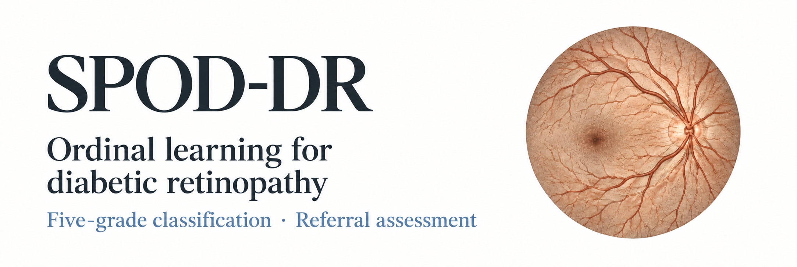
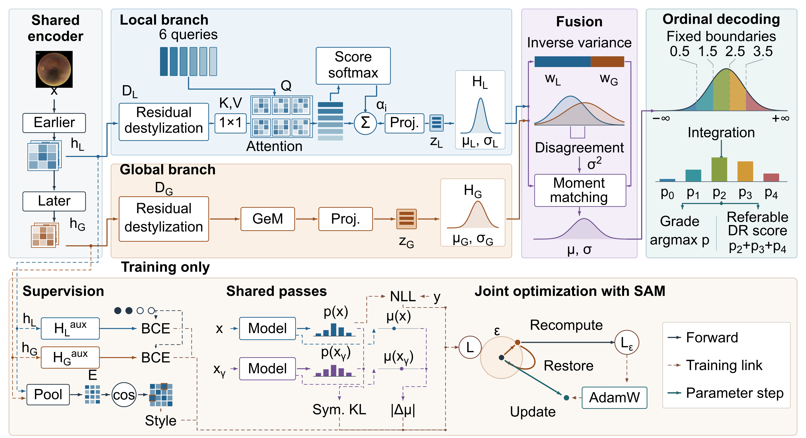

# SPOD-DR

SPOD-DR combines local and global severity distributions for five-grade diabetic retinopathy classification and referral.

[Quick start](#quick-start) · [Models](#model-downloads) · [Usage and training](docs/USAGE.md) · [Results and figures](docs/RESULTS.md)

## Method overview

[](docs/assets/spod-dr/method-overview.svg)

Local query aggregation and global pooling produce two severity distributions. Inverse-variance fusion accounts for branch disagreement; ordinal integration yields grade probabilities and a referral score. The lower panel shows auxiliary supervision and joint optimization with SAM; xγ denotes the gamma-transformed input. Intermediate representations are schematic.

[Vector figure](docs/assets/spod-dr/method-overview.svg).

## Experiments

Five backbones: EfficientNet-B0, EfficientNet-B3, ConvNeXt-Tiny, ResNet-50, and Swin-Tiny.

| Experiment | Checkpoints | Results |
|---|---:|---|
| SPOD-DR | 5 | [main.csv](results/main.csv) |
| Ablation studies | 15 | [ablation.csv](results/ablation.csv) |
| Sensitivity analysis (K and rho) | 40 | [sensitivity.csv](results/sensitivity.csv) |
| Standard classifier baselines | 5 | [native.csv](results/native.csv) |

All experiments cover the five backbones. The default is `K=6, rho=0.025`.

[Results, figures, and metric definitions](docs/RESULTS.md)

## Quick start

Use Python 3.11 and a compatible PyTorch/torchvision pair for your hardware. Run commands from the repository root:

```bash
python -m pip install -r requirements.txt
```

1. Download the required model archive from [v1.0.0](https://github.com/9999993/SPOD-DR/releases/tag/v1.0.0) and extract its `checkpoints/` directory into the repository root.
2. Follow the [preprocessing and input-manifest guide](docs/USAGE.md#input-manifest) to prepare `local-data/inputs.json`. Inputs are ImageNet-normalized float32 caches of shape `(3, 512, 512)`.
3. Run inference with a new output directory:

```bash
python src/scripts/release_predict.py --family main --backbone SwinTiny --inputs local-data/inputs.json --output runs/swin-predictions --device cuda --batch-size 1
```

Use `--device cpu` for CPU inference. Outputs include grade predictions and referral decisions using the model's fixed threshold. See the [usage guide](docs/USAGE.md) for other model families, training, and confidence intervals.

## Model downloads

| Archive | Contents |
|---|---|
| [spod-dr-main.zip](https://github.com/9999993/SPOD-DR/releases/download/v1.0.0/spod-dr-main.zip) | 5 main models and their policies |
| [spod-dr-ablation.zip](https://github.com/9999993/SPOD-DR/releases/download/v1.0.0/spod-dr-ablation.zip) | 15 ablation models and their policies |
| [spod-dr-sensitivity-k.zip](https://github.com/9999993/SPOD-DR/releases/download/v1.0.0/spod-dr-sensitivity-k.zip) | 16 query-count sensitivity models and their policies |
| [spod-dr-sensitivity-rho.zip](https://github.com/9999993/SPOD-DR/releases/download/v1.0.0/spod-dr-sensitivity-rho.zip) | 16 rho sensitivity models and their policies |
| [spod-dr-sensitivity-swin.zip](https://github.com/9999993/SPOD-DR/releases/download/v1.0.0/spod-dr-sensitivity-swin.zip) | 8 Swin-Tiny K/rho models and their policies |
| [spod-dr-native.zip](https://github.com/9999993/SPOD-DR/releases/download/v1.0.0/spod-dr-native.zip) | 5 standard classifier baselines matching the paper and their policies |
| [spod-dr-native-parents.zip](https://github.com/9999993/SPOD-DR/releases/download/v1.0.0/spod-dr-native-parents.zip) | 5 native continuation parent checkpoints |

The [model index](checkpoints/models.csv) maps each final weight to its configuration, POLICY, and results. To build a parent checkpoint, use the [baseline base-training entry](docs/USAGE.md#classifier-baseline-training) with [public initialization](docs/USAGE.md#public-initialization).

Saved predictions for confidence intervals: [spod-dr-ci-inputs.zip](https://github.com/9999993/SPOD-DR/releases/download/v1.0.0/spod-dr-ci-inputs.zip). Extract its `local-data/ci/` directory into the repository root and follow the [CI commands](docs/USAGE.md#confidence-intervals).

## Repository layout

| Directory | Contents |
|---|---|
| `src/scripts/` | Model, training, selection, calibration, and inference code |
| `configs/` | Experiment settings and example data configuration |
| `checkpoints/` | Model index, policies, and extracted weights |
| `data/` | Preprocessing code and study membership tables |
| `results/` | Model-linked result tables and confidence intervals |
| `docs/` | Usage guide, result gallery, and figure source tables |
| `reproduce/ci/` | Confidence intervals from saved predictions |
| `tests/` | Interface and implementation tests |

## Data and evaluation

| Split | Images | Purpose |
|---|---:|---|
| TRAIN | 23,987 | Fit model weights |
| DEV | 2,984 | Select a checkpoint |
| CAL | 2,524 | Set the referral threshold |

Each configuration has its own selected checkpoint and CAL-fitted threshold. CAL selects the highest threshold whose one-sided 90% Wilson lower bound for sensitivity is at least 0.90.

All released model families share the [same study splits](data/manifests/model_splits.csv). Weights and thresholds are then fixed for evaluation on **DDR (12,422 images), IDRiD (103), and MESSIDOR-2 (1,744)**, excluded from TRAIN, DEV, and CAL.

Use the [data preparation guide](docs/USAGE.md#data-preparation) to obtain dataset images and prepare local inputs.

## License

Code, documentation, and released SPOD-DR checkpoints use the [MIT License](LICENSE). External dependencies, pretrained initialization weights, and datasets retain their own terms; see [third-party notices](THIRD_PARTY_NOTICES.md).
