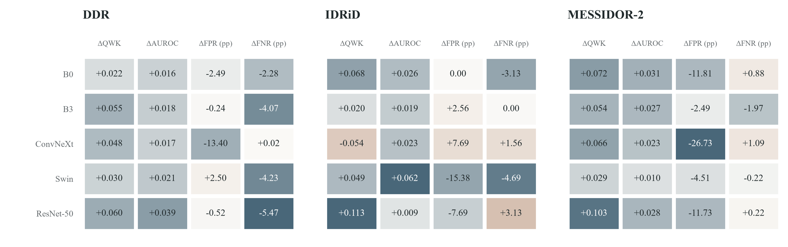
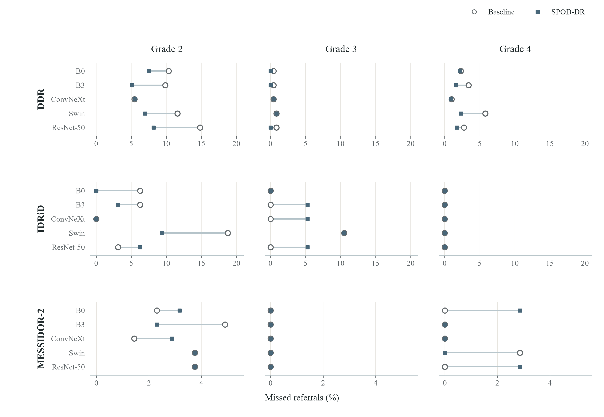
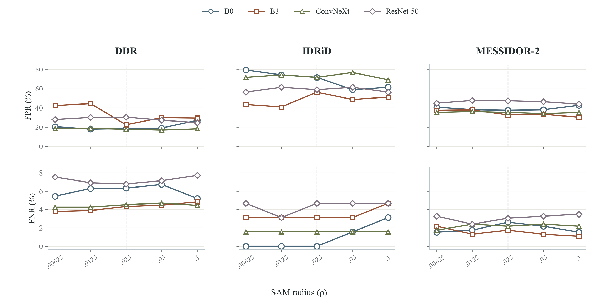
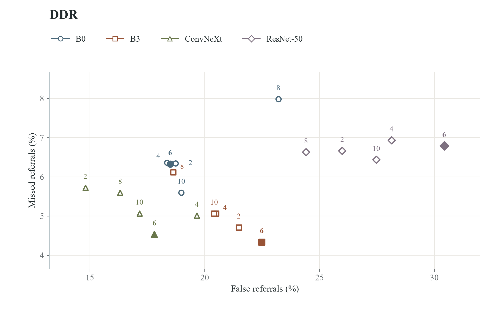
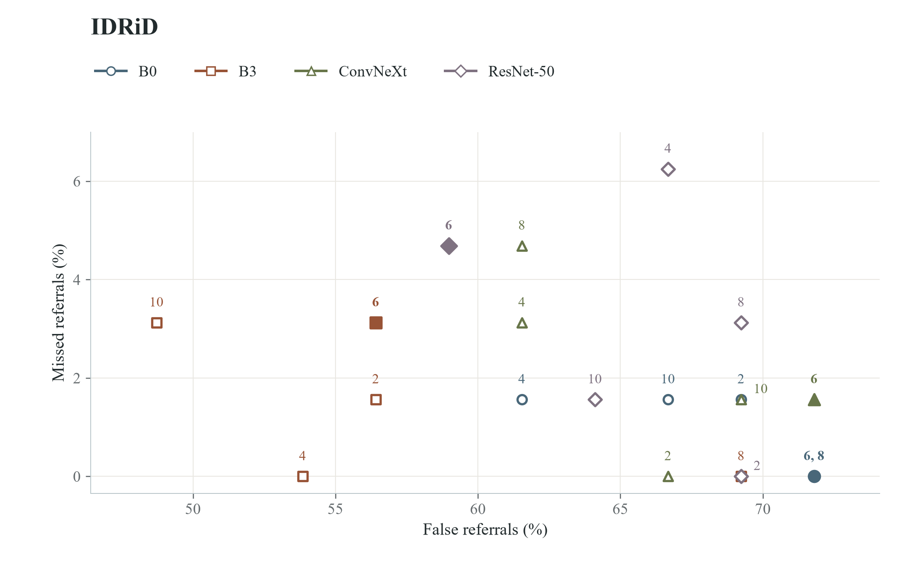
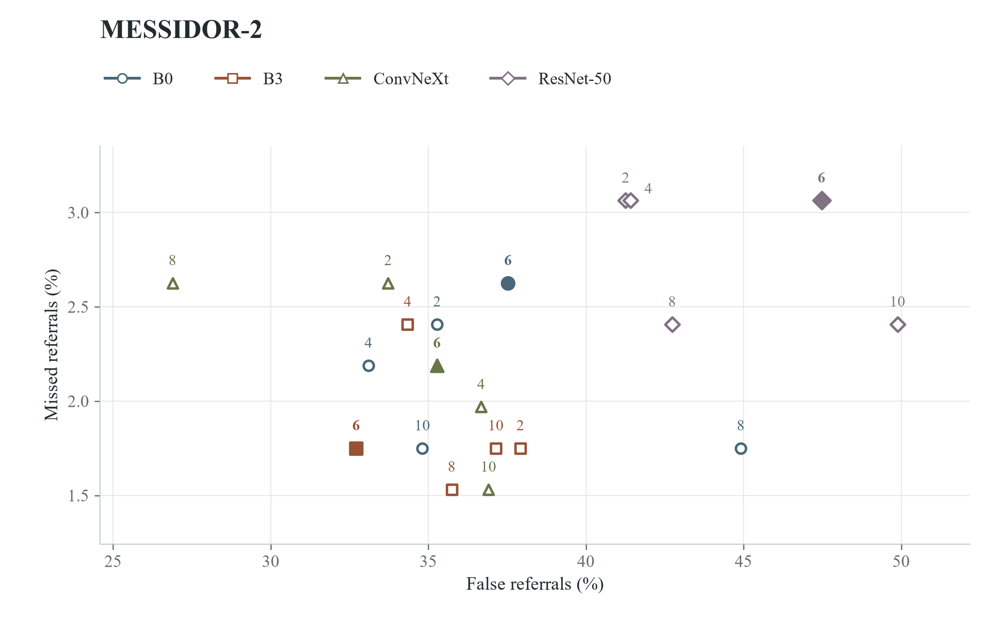
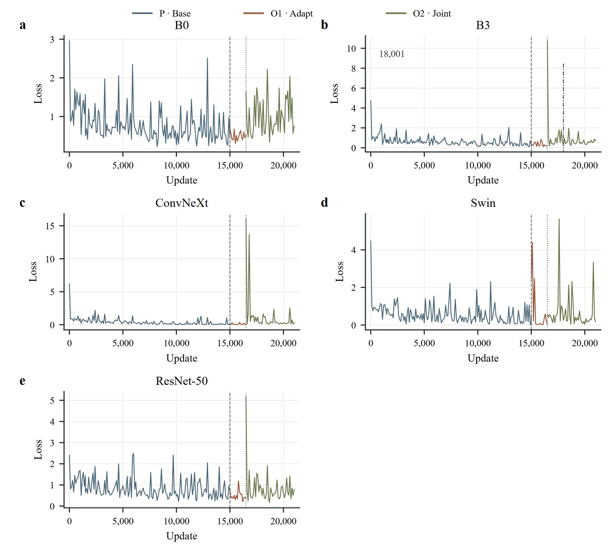

# Experimental results

Results across DDR, IDRiD, and MESSIDOR-2, with vector figures and aggregate source tables. [Back to the repository](../README.md).

## Reading the figures

QWK measures ordinal grading agreement; AUROC measures referral discrimination. FPR is the false-referral rate among grades 0–1; FNR is the missed-referral rate among grades 2–4. Rates are percentages and rate differences are percentage points (pp).

Figure labels use B0/B3 for EfficientNet-B0/B3, ConvNeXt for ConvNeXt-Tiny, and Swin for Swin-Tiny.

The [model index](../checkpoints/models.csv) covers all five SPOD-DR models, standard classifier baselines, and component ablations. See [metric definitions](#metrics) below.

S7 also includes ORDER-DR results; S8 compares SPOD-DR with the EfficientNet-B3 backbone against ORDER-DR. Aggregate results and saved ORDER-DR predictions are available through the [CI commands](USAGE.md#confidence-intervals).

## Main results

Each entry is SPOD-DR minus its same-backbone baseline (manuscript Figure 2). Blue indicates a favorable change; brown indicates an unfavorable change. Color intensity is scaled within each metric. Paired 95% confidence intervals are reported in S8.

[Vector figure](assets/spod-dr/experiments/Fig2_main_results.svg) · [Main values, Table 2](assets/spod-dr/experiment-data/main_table2.csv) · [Absolute results and 95% CIs, S7](assets/spod-dr/experiment-data/absolute_metrics_ci.csv) · [Paired differences and 95% CIs, S8](assets/spod-dr/experiment-data/paired_differences_S9.csv)

## Ablation studies

[Complete five-backbone ablation table, S10](assets/spod-dr/experiment-data/ablation_S2.csv)

FULL, NO_DESTYLE, NO_LOCAL, and NO_SAM cover five backbones and three cohorts (60 rows). FULL repeats the main model. Each configuration has its own selected checkpoint and CAL threshold; removing the local branch also changes model capacity.

## Grade-specific missed referrals

Baseline is an open circle; SPOD-DR is a filled square. Leftward shifts mean fewer missed referrals. All grades share a horizontal scale within each cohort; scales differ between cohorts. Denominators for grades 2/3/4 are 4,477/236/913 (DDR), 32/19/13 (IDRiD), and 347/75/35 (MESSIDOR-2). Lines connect the two models’ grade-specific rates.

[Vector figure](assets/spod-dr/experiments/grade_comparison.svg) · [All grade counts, S9](assets/spod-dr/experiment-data/grade_counts_S10.csv)

## SAM perturbation radius

Rho is the SAM training perturbation radius. Four non-Swin backbones are shown with K fixed at 6. The horizontal axis uses a log2 scale; the dashed line marks the default rho of 0.025. Lines connect the point estimates for each configuration.

[Vector figure](assets/spod-dr/experiments/rho_response.svg) · [Complete table S11](assets/spod-dr/experiment-data/rho_S3.csv)

## Query-count trade-offs

Each point is a K setting at rho = 0.025. The axes show FPR and FNR; lower is better on both. Labels give K, and filled symbols mark K = 6. Labels are offset where points overlap.

### DDR

[Vector figure](assets/spod-dr/experiments/K_DDR.svg)

### IDRiD

[Vector figure](assets/spod-dr/experiments/K_IDRiD.svg)

### MESSIDOR-2

[Vector figure](assets/spod-dr/experiments/K_MESSIDOR-2.svg) · [Complete table S12](assets/spod-dr/experiment-data/K_S4.csv)

The rho and K tables share 12 default records: 120 displayed rows represent 108 unique configuration/backbone/dataset outcomes. The default setting is shared by both scans.

## Training curves

P, O1, and O2 denote base training, readout adaptation, and joint optimization. Phase boundaries are 15,001 and 16,501; B3 selects step 18,001. Each panel uses its own loss scale. Curves are reproduced from supplementary Figure S6; S13 gives the first and last recorded losses for each phase.

[Vector figure](assets/spod-dr/experiments/FigS1_training_loss.svg) · [Training summary S13](assets/spod-dr/experiment-data/training_summary_S6.csv) · [DEV records S14](assets/spod-dr/experiment-data/validation_S7.csv) · [Selected checkpoints and thresholds S5](assets/spod-dr/experiment-data/thresholds_S8A.csv) · [CAL results S6](assets/spod-dr/experiment-data/calibration_S8B.csv)

## Result tables

| File | Rows | Contents |
|---|---:|---|
| [main.csv](../results/main.csv) | 15 | Five main models across three cohorts |
| [ablation.csv](../results/ablation.csv) | 60 | FULL and three ablations for five backbones |
| [sensitivity.csv](../results/sensitivity.csv) | 108 | K and rho settings for four backbones |
| [native.csv](../results/native.csv) | 15 | Five classifier baselines across three cohorts |

`release_artifact_id` connects these rows to the [model index](../checkpoints/models.csv). FULL/default rows reuse main-model results.

## Metrics

| Field | Meaning and units |
|---|---|
| images | DDR 12,422; IDRiD 103; MESSIDOR-2 1,744 |
| positive / negative | Grades 2–4 / grades 0–1 |
| qwk / auroc | Dimensionless |
| false_referral_grade01 / FR_* | False referrals among grades 0–1 |
| miss_grade234 / MISS_* | Missed referrals among grades 2–4 |
| *_numerator / *_denominator | Event count / applicable population size |
| estimate / ci95_low / ci95_high | Estimate and 95% interval; event rates use the 0–1 scale |
| delta_pp / ci95_*_pp | Percentage points |
| units / resampling_unit | Images for DDR/IDRiD; official examination groups for MESSIDOR-2 |

Grade-specific rates use the corresponding grade as their denominator. Blank optional fields indicate unavailable values. Save new experiment outputs under `runs/`.

## Confidence intervals

| Table | Rows | Comparison |
|---|---:|---|
| [ci/native_absolute.csv](../results/ci/native_absolute.csv) | 60 | Absolute metrics for the five classifier baselines |
| [ci/swin_absolute.csv](../results/ci/swin_absolute.csv) | 48 | Absolute metrics for Swin-Tiny FULL and its three ablations |
| [ci/main_vs_native.csv](../results/ci/main_vs_native.csv) | 60 | SPOD-DR minus the same-backbone classifier baseline |
| [ci/swin_ablation_paired.csv](../results/ci/swin_ablation_paired.csv) | 36 | Each Swin-Tiny ablation minus FULL |

For main-minus-baseline differences, positive QWK/AUROC and negative FPR/FNR favor SPOD-DR. For ablation-minus-FULL differences, the same signs favor the ablation. Model identifiers and `release_artifact_id` identify the compared checkpoints.

Bootstrap intervals use 10,000 non-stratified draws (seed 20261016), shared resampling for paired differences, and percentile limits. DDR and IDRiD use image-level resampling; MESSIDOR-2 uses 874 official examination groups (870 pairs and four singletons). `components` is a separate grouping field. Cohort order and examination groups are supplied with the CI code. Model weights and CAL thresholds remain fixed; intervals are unadjusted for multiple comparisons.

For zero-event absolute missed-referral rates on IDRiD (0/64), supplementary Table S7 uses a two-sided Clopper–Pearson exact binomial interval of 0–5.60%. The ConvNeXt-Tiny baseline row records that published precision as 0–0.056; bootstrap fields are empty for this row. Paired differences use bootstrap intervals throughout.

ORDER-DR uses the seed-2101 CODE system, two equally weighted B0 members, and its fixed UNIFIED_CAL threshold. S8 compares SPOD-DR B3 minus ORDER-DR, separately from same-backbone comparisons. Paired differences are computed before rounding.

## Figure source tables

| CSV | Current table | Rows | Contents |
|---|---|---:|---|
| [main_table2.csv](assets/spod-dr/experiment-data/main_table2.csv) | Table 2 | 30 | Five same-backbone comparisons across three cohorts |
| [ablation_S2.csv](assets/spod-dr/experiment-data/ablation_S2.csv) | S10 | 60 | FULL and three component ablations for all five backbones |
| [rho_S3.csv](assets/spod-dr/experiment-data/rho_S3.csv) | S11 | 60 | Five SAM radius settings for four backbones |
| [K_S4.csv](assets/spod-dr/experiment-data/K_S4.csv) | S12 | 60 | Five query counts for four backbones |
| [absolute_metrics_ci.csv](assets/spod-dr/experiment-data/absolute_metrics_ci.csv) | S7 | 132 | Absolute metrics, 95% CIs, and available event counts |
| [paired_differences_S9.csv](assets/spod-dr/experiment-data/paired_differences_S9.csv) | S8 | 72 | Paired differences and 95% CIs, including ORDER-DR comparisons |
| [grade_counts_S10.csv](assets/spod-dr/experiment-data/grade_counts_S10.csv) | S9 | 90 | Missed referrals and denominators for grades 2–4 |
| [training_summary_S6.csv](assets/spod-dr/experiment-data/training_summary_S6.csv) | S13 | 15 | First/last recorded losses for each backbone and training phase |
| [validation_S7.csv](assets/spod-dr/experiment-data/validation_S7.csv) | S14 | 25 | DEV selection records |
| [thresholds_S8A.csv](assets/spod-dr/experiment-data/thresholds_S8A.csv) | S5 | 5 | Selected main-model steps and fixed referral thresholds |
| [calibration_S8B.csv](assets/spod-dr/experiment-data/calibration_S8B.csv) | S6 | 10 | Main-model and baseline CAL sensitivity records |

CSV filenames and `source` labels retain the original numbering; the table column above follows the current supplement. Values retain the reported precision. QWK and AUROC are dimensionless; `_pct` fields, S7 `percent` rows, and S8 `percentage_points` rows use the 0–100 scale. DEV and CAL tables describe model selection and threshold fitting.
